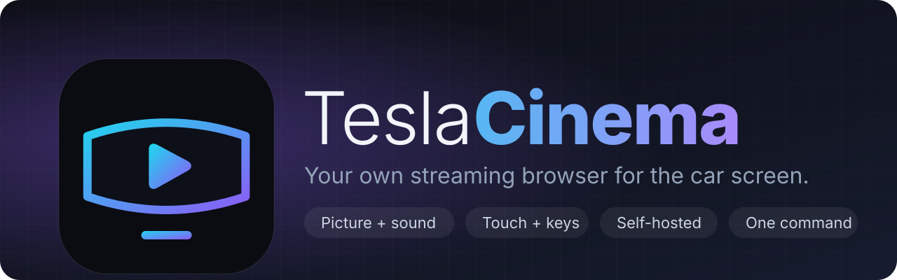
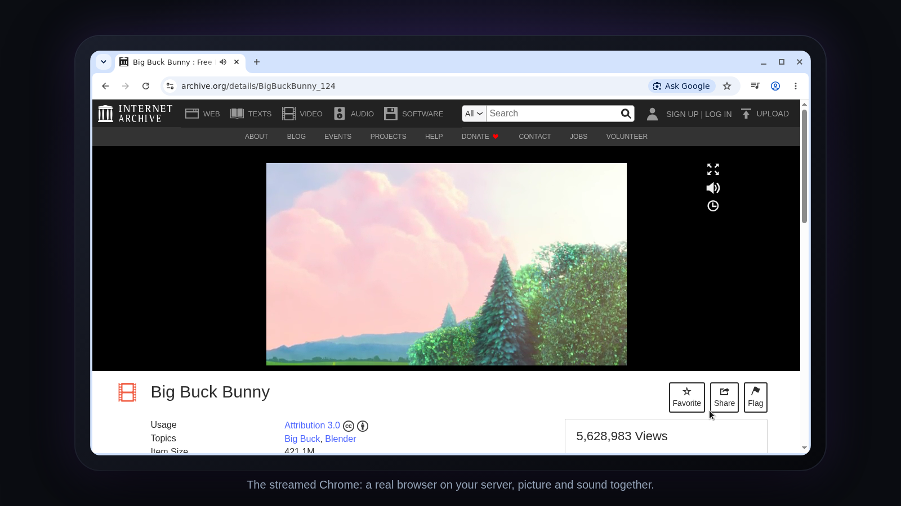

<div align="center">



<br>

[](LICENSE)
[](docs/getting-started.md)

[English](README.md) · **Deutsch**

</div>

TeslaCinema startet einen **echten Google Chrome auf deinem eigenen Server** und streamt **Bild und Ton** zum Browser im
Auto. Du tippst, scrollst und schreibst auf dem Touchscreen des Autos, den Rest macht Chrome auf dem Server. Alles, was im
Desktop-Chrome läuft, läuft auch auf dem Auto-Bildschirm: deine Abos, deine Logins, deine Erweiterungen.

Ein Container. Ein Befehl.

```bash
git clone https://github.com/therealMRBK/TeslaCinema.git && cd TeslaCinema && ./setup.sh
```

<p align="center"></p>

> ## ⚠️ HINWEIS: NUR IM STAND. NIEMALS WÄHREND DER FAHRT.
> **TeslaCinema darf auf gar keinen Fall während der Fahrt benutzt werden.** Das Ansehen von Videos oder das Bedienen eines
> Bildschirms während der Fahrt ist **in der Europäischen Union gesetzlich verboten** (durch die Straßenverkehrsgesetze der
> Mitgliedstaaten, in Deutschland zum Beispiel § 23 StVO) und in den meisten anderen Ländern ebenfalls. Außerdem ist es
> lebensgefährlich.
> Nutze es **ausschließlich bei stehendem, sicher geparktem Fahrzeug**, zum Beispiel beim Laden, Warten oder in der Pause.
> Der Fahrer ist immer selbst dafür verantwortlich, das Gesetz einzuhalten und das Fahrzeug sicher zu führen. Die Autoren und
> Mitwirkenden übernehmen **keine Haftung** für Nutzung entgegen der Verkehrsvorschriften oder für daraus entstehende Unfälle,
> Schäden, Bußgelder oder Verletzungen. Dies ist keine Rechtsberatung.

## Was du bekommst

- 🎬 **Bild und Ton im Gleichlauf**: ein ffmpeg nimmt Bildschirm und Ton in einen gemeinsamen MPEG-TS-Strom auf.
- 👆 **Für Touchscreens gebaut**: Tippen = Klick, Wischen = Scrollen, Halten = Rechtsklick. Die Bildschirmtastatur des
  Autos öffnet sich von selbst, wenn du in ein Textfeld tippst.
- 🌐 **Ein normaler Chrome**: Logins und Cookies bleiben in einem Docker-Volume erhalten, Widevine ist dabei.
- 🔐 **Login eingebaut**: HTTP Basic Auth, ein zufälliges Passwort wird für dich erzeugt, ohne Passwort startet der Server nicht.
- 📡 **Einfach ins Internet**: Das Auto braucht eine öffentliche https-Adresse. `./setup.sh` öffnet auf Wunsch einen
  kostenlosen Cloudflare-Tunnel (ohne Konto, ohne Portfreigabe) oder holt mit Caddy ein Zertifikat für deine Domain.
- 🖥️ **Jeder x86-64-Rechner mit Docker**: Mini-PC, NAS, VPS, Proxmox-VM, alter Laptop.

## Schnellstart

Du brauchst einen **x86-64-Rechner mit Docker und Docker Compose v2**.
Noch kein Docker? Anleitungen für [Linux](docs/install-linux.md), [Windows](docs/install-windows.md),
[macOS](docs/install-macos.md) und [NAS-Systeme](docs/install-nas.md) (auf Englisch).

```bash
git clone https://github.com/therealMRBK/TeslaCinema.git
cd TeslaCinema
./setup.sh
```

Das Skript prüft Docker, legt `.env` mit **zufälligem Passwort** an, fragt, wie das Auto den Server erreichen soll
(Standard: kostenloser Cloudflare-Quick-Tunnel), baut das Image (beim ersten Mal lädt es Chrome herunter, einige Minuten)
und zeigt am Ende **Adresse, Benutzer und Passwort**.

Öffne die Adresse zuerst am PC oder Handy, melde dich an, dann siehst du ein Chrome-Fenster. Danach dieselbe Adresse im
Browser des Autos.

Ohne Rückfragen:

```bash
./setup.sh --mode quick-tunnel                              # Cloudflare-Tunnel, nichts einzustellen
./setup.sh --mode domain --domain kino.example.com          # eigene Domain, automatisches https mit Caddy
./setup.sh --mode lan                                       # nur http im Heimnetz, zum ersten Testen
./setup.sh --mode proxy                                     # du hast schon einen Reverse-Proxy
```

## Alles weitere (auf Englisch)

| Ich möchte ... | Lesen |
|---|---|
| In 5 Minuten loslegen | [Getting started](docs/getting-started.md) |
| https für das Auto einrichten | [Cloudflare-Tunnel](docs/https-cloudflare-tunnel.md) · [Caddy + eigene Domain](docs/https-caddy.md) · [Nginx Proxy Manager, nginx, Traefik](docs/reverse-proxies.md) |
| Im Auto benutzen | [Using it in the car](docs/using-in-the-car.md) |
| Sprache, Qualität, Port ändern | [Configuration](docs/configuration.md) |
| Probleme lösen | [Troubleshooting](docs/troubleshooting.md) · [FAQ](docs/faq.md) |
| Sicherheit | [Security](docs/security.md) |
| Aktualisieren / entfernen | [Updating and uninstalling](docs/updating-and-uninstalling.md) |

**Sprache der Chrome-Oberfläche:** in `.env` `LOCALE=de_DE.UTF-8` setzen, danach `docker compose up -d`.

## Hinweise

- **Nicht verbunden mit Tesla.** TeslaCinema ist ein unabhängiges Open-Source-Projekt. „Tesla" ist eine Marke von Tesla,
  Inc. und wird hier nur genannt, um zu sagen, für welchen Auto-Browser das Projekt gebaut ist. Das Logo ist eigenständig.
- **Dein Konto, deine Bedingungen.** Der Server betreibt einen gewöhnlichen Chrome. Es werden keine Schutzmaßnahmen umgangen.
- **Raspberry Pi / Apple Silicon:** nicht unterstützt, weil es Google Chrome nicht für Linux-arm64 gibt.
- **Login nie abschalten.** Wer eine ungeschützte Instanz erreicht, steuert einen Browser, der in deinen Konten angemeldet ist.

## Mitmachen und Lizenz

Fehlerberichte, Erfahrungsberichte aus echten Autos und Pull Requests sind willkommen: [CONTRIBUTING.md](CONTRIBUTING.md).
Lizenz: [MIT](LICENSE). Drittanbieter-Software: [THIRD_PARTY.md](THIRD_PARTY.md).
