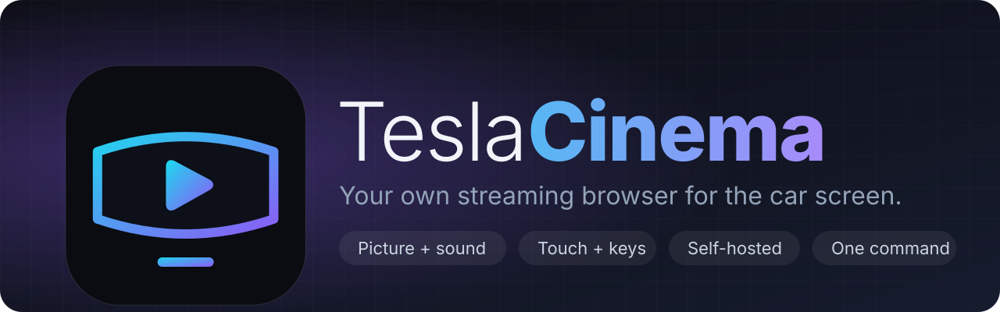
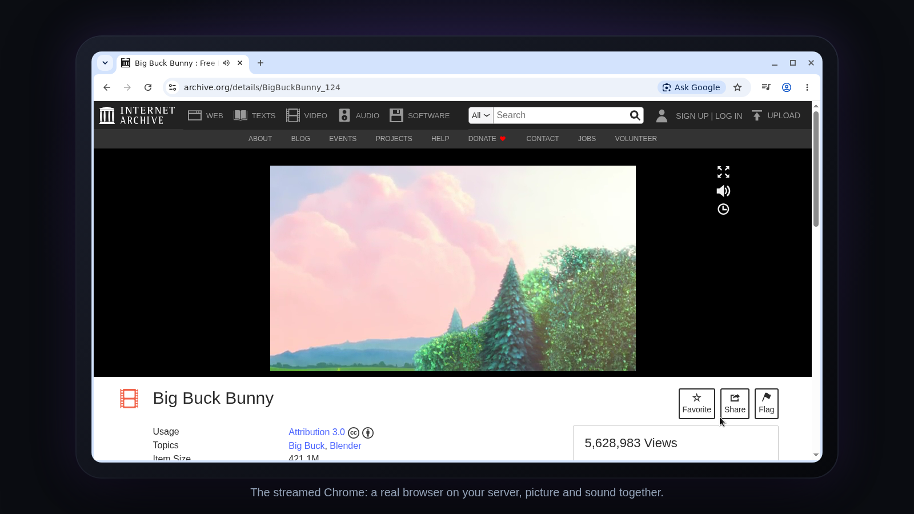

<div align="center">



<br>

[](LICENSE)
[](docs/getting-started.md)
[-64748b.svg)](docs/faq.md#does-it-run-on-a-raspberry-pi-or-an-apple-silicon-mac)
[](https://github.com/therealMRBK/TeslaCinema/actions/workflows/ci.yml)

**English** · [Deutsch](README.de.md)

</div>

TeslaCinema runs a **real Google Chrome on your own server** and streams its picture **and sound** to the web browser
in your car. You tap, scroll and type on the car's touchscreen; Chrome on your server does the rest. Every site that
plays in desktop Chrome plays on the car screen: your subscriptions, your logins, your extensions.

It is one container. One command sets it up.

```bash
git clone https://github.com/therealMRBK/TeslaCinema.git && cd TeslaCinema && ./setup.sh
```

<p align="center"></p>

> ## ⚠️ DISCLAIMER: PARKED ONLY. NEVER WHILE DRIVING.
> **TeslaCinema must never be used while driving.** Watching video or operating a screen while driving is
> **prohibited by law in the European Union** (through the road traffic laws of its member states, for example § 23 StVO in
> Germany) and in most other countries. It is also extremely dangerous.
> Use it **only while the vehicle is stationary and safely parked**: while charging, waiting or on a break.
> The driver is always fully responsible for complying with the law and for safe operation of the vehicle. The authors and
> contributors accept **no liability** for any use that violates traffic laws or leads to accidents, damage, fines or
> injury. This is not legal advice. See [Safety and legal](#safety-and-legal).

---

## What you get

- 🎬 **Picture and sound in sync.** One ffmpeg captures screen and audio into a single MPEG-TS stream, so both share
  one clock. The page decodes it with [JSMpeg](https://github.com/phoboslab/jsmpeg) and plays the sound through Web
  Audio. No `<video>` element, nothing the car browser has to support beyond canvas and Web Audio.
- 👆 **Made for a touchscreen.** Tap = click, drag = scroll, hold = right click, two fingers = scroll. The car's
  on-screen keyboard opens by itself when you tap a text field and closes again afterwards.
- 🌐 **A normal Chrome.** Launched like any desktop app, without automation flags. Logins, cookies and extensions
  persist in a Docker volume. Chrome includes Widevine, so services that need it work like on a desktop.
- 🔐 **Login built in.** HTTP Basic Auth, a random password generated for you, and the server refuses to start
  without one.
- 📡 **Easy to put on the internet.** The car needs a public https address. `./setup.sh` can open a free Cloudflare
  tunnel (no account, no port forwarding) or fetch a certificate for your own domain with Caddy.
- 🛠️ **Adaptive.** The picture follows the size of the browser window, the stream skips ahead instead of piling up
  delay on a slow line, and the bitrate is one setting away.
- 🖥️ **Any x86-64 machine with Docker**: a mini PC, a NAS, a VPS, a Proxmox VM, a spare laptop.

## How it fits together

```
 Car browser ──https──▶  Cloudflare tunnel / Caddy / your reverse proxy
 (picture, sound,                        │
  touch, keyboard)                       ▼
                         ┌────────────── TeslaCinema container ───────────────┐
                         │  Node server (login, stream, input)                │
                         │   ├─ ffmpeg: screen + sound ──▶ MPEG-TS stream     │
                         │   ├─ xhelper / xdotool: mouse, touch, keys         │
                         │   └─ Xvfb + Fluxbox + Google Chrome + PulseAudio   │
                         └────────────────────────────────────────────────────┘
```

## Quick start

You need an **x86-64 machine with Docker and Docker Compose v2** and a few minutes.
No Docker yet? See the [install guides](docs/index.md#install-docker-and-teslacinema) for Linux, Windows, macOS and NAS systems.

```bash
git clone https://github.com/therealMRBK/TeslaCinema.git
cd TeslaCinema
./setup.sh
```

The script

1. checks Docker,
2. creates `.env` with a **random password**,
3. asks how the car should reach it (default: a free Cloudflare quick tunnel),
4. builds the image (the first build downloads Chrome, a few minutes) and starts it,
5. prints the **address, user name and password**.

Open that address on your PC or phone first, log in, and you should see a Chrome window. Then open the same address
in the car's browser. Details: [docs/using-in-the-car.md](docs/using-in-the-car.md).

Non-interactive variants:

```bash
./setup.sh --mode quick-tunnel                              # free Cloudflare tunnel, nothing to configure
./setup.sh --mode domain --domain cinema.example.com        # your domain, automatic https with Caddy
./setup.sh --mode lan                                       # plain http on your home network, for a first test
./setup.sh --mode proxy                                     # you already run a reverse proxy
```

Prefer to do it by hand? `cp .env.example .env`, set `AUTH_PASSWORD`, then `docker compose up -d --build`.

## Documentation

| I want to... | Read |
|---|---|
| Get it running in 5 minutes | [Getting started](docs/getting-started.md) |
| Install Docker | [Linux](docs/install-linux.md) · [Windows](docs/install-windows.md) · [macOS](docs/install-macos.md) · [NAS: Unraid, Synology, Portainer, Proxmox](docs/install-nas.md) |
| Make it reachable from the car (https) | [Cloudflare tunnel](docs/https-cloudflare-tunnel.md) · [Caddy + own domain](docs/https-caddy.md) · [Nginx Proxy Manager, nginx, Traefik](docs/reverse-proxies.md) |
| Use it in the car | [Using it in the car](docs/using-in-the-car.md) |
| Change language, quality, port | [Configuration](docs/configuration.md) |
| Use a GPU | [GPU](docs/gpu.md) |
| Keep it safe | [Security](docs/security.md) |
| Fix a problem | [Troubleshooting](docs/troubleshooting.md) · [FAQ](docs/faq.md) |
| Update or remove it | [Updating and uninstalling](docs/updating-and-uninstalling.md) |
| Understand the internals | [How it works](docs/how-it-works.md) |

## Requirements

| | |
|---|---|
| Host CPU | **x86-64 (amd64).** Google Chrome has no Linux arm64 build, so Raspberry Pi and Apple Silicon hosts are not supported (details in the [FAQ](docs/faq.md#does-it-run-on-a-raspberry-pi-or-an-apple-silicon-mac)). |
| Software | Docker Engine 24+ with Compose v2 (or Docker Desktop) |
| Resources | The video is encoded in software: plan for **2+ CPU cores and 2 GB RAM**, more for 1080p at 30 fps. See [Configuration](docs/configuration.md#picture-quality). |
| Network | Upstream bandwidth at home (or your server) of at least the stream bitrate, default **3.5 Mbit/s**, and a public https address for the car |
| Car | A browser and an internet connection in the car (a phone hotspot, Wi-Fi, or the car's own mobile data) |

## Safety and legal

- **Parked only, by law.** In the EU, using a screen to watch video or browse while driving is prohibited by national road traffic laws, and it is dangerous. TeslaCinema is meant for waiting, charging and breaks, with the vehicle stationary and safely parked. The driver is responsible for obeying the law; the authors accept no liability for misuse. Do not use it on a moving vehicle, and do not let others do so.
- **Your accounts, your terms.** The server runs an ordinary Chrome and plays whatever you log into. It does not
  remove or bypass any protection. Make sure that what you watch, and where you watch it, is allowed by the terms of
  the services you use.
- **Keep the login on.** Anyone who reaches an unprotected instance controls a browser that is logged into your
  accounts. See [Security](docs/security.md).
- **Not affiliated.** TeslaCinema is an independent open-source project. It is not made, endorsed or sponsored by
  Tesla, Inc. "Tesla" is a trademark of Tesla, Inc., used here only to say which car browser the project is built for.
  The logo is original and does not use any Tesla mark.
- **Works with other cars too.** Any browser that can show a canvas and play Web Audio can use it.

## Status

TeslaCinema grew out of a private remote-browser tool and is built around the capabilities measured in a Tesla
browser (Chromium, touch, WebSocket allowed, a few Mbit/s on mobile data). On a local network, picture and sound stay
within about ±60 ms of each other and a tap shows up on screen after roughly 150-400 ms (see
[How it works](docs/how-it-works.md#measured-numbers)). Reports from real cars and other setups are very welcome:
please open an [issue](https://github.com/therealMRBK/TeslaCinema/issues).

## Contributing

Bug reports, ideas and pull requests are welcome. See [CONTRIBUTING.md](CONTRIBUTING.md). Security problems: see
[SECURITY.md](SECURITY.md).

## License

[MIT](LICENSE). Third-party components are listed in [THIRD_PARTY.md](THIRD_PARTY.md).
